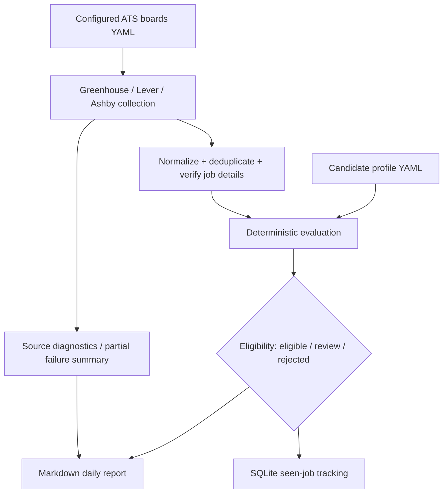
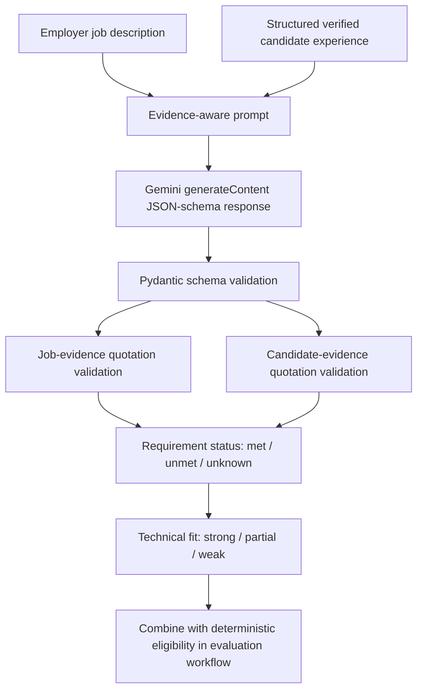
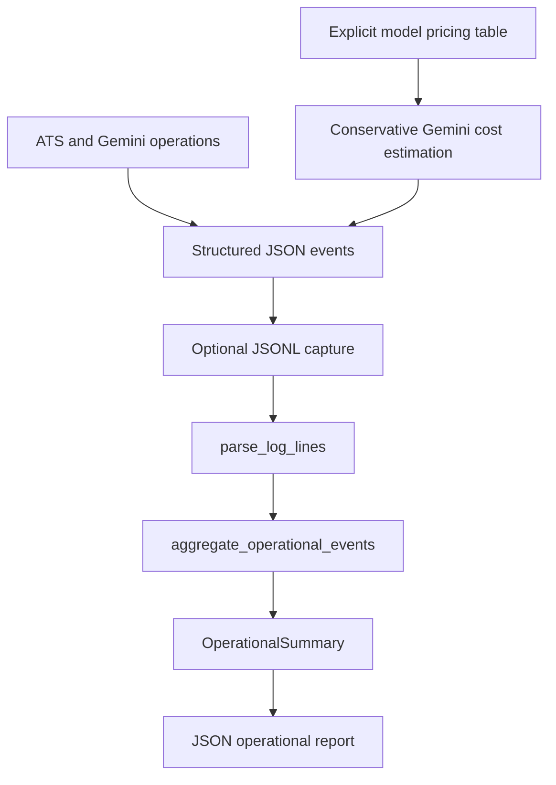
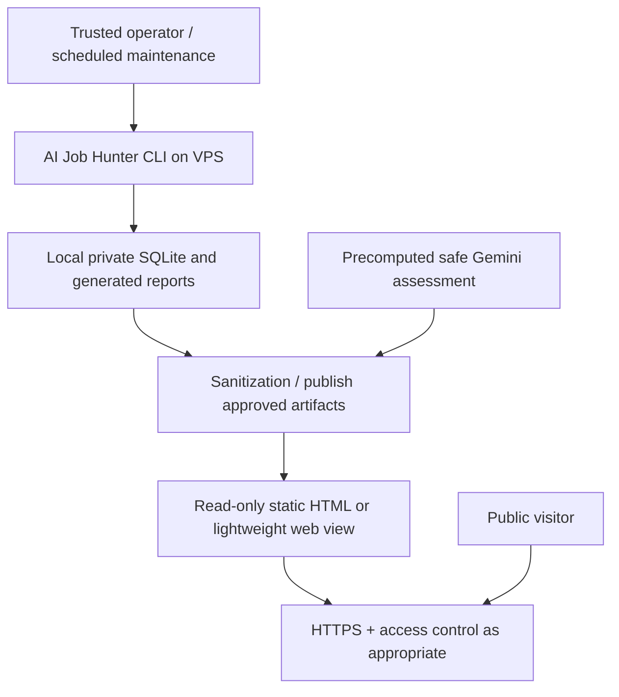

# AI Job Hunter — Engineering Architecture, Trade-offs & Portfolio Demo Background

**Purpose:** A durable source document for explaining the engineering choices behind AI Job Hunter, producing portfolio architecture documentation, and planning a reproducible demonstration or VPS deployment.

**Repository:** [kamilloo/AI-Job-Hunter](https://github.com/kamilloo/AI-Job-Hunter)  
**Reference point:** Repository `master` and project discussion reviewed November 2026.  
**Status vocabulary:** **Implemented** = present in the reviewed repository/project record; **Verified manually** = observed during manual execution; **Deferred/proposed** = not yet delivered or not independently verified.  
**Scope:** This is an engineering/design background document, not an assertion that every future deployment feature already exists.

---

## 1. Executive narrative — what the application solves

AI Job Hunter is a Python application for discovering real vacancies on selected company ATS boards, comparing them with a configurable candidate profile, and producing explainable recommendations. Its initial use case is finding backend, platform, and AI-transition opportunities potentially compatible with working remotely from Poland. The candidate profile and sources are configurable.

The essential challenge is **not** finding jobs with matching keywords. It is making trustworthy decisions when employer requirements are ambiguous, geographic restrictions are hard constraints, and an LLM may produce persuasive but unsupported explanations.

The engineering thesis:

> **Deterministic rules decide verifiable restrictions; AI interprets ambiguous technical requirements; structured evidence, validation, tests, and observability make both paths inspectable.**

The system is not a broad job crawler, does not submit applications automatically, and does not claim to predict hiring outcomes.

**Portfolio story (30 seconds):** “I built a hybrid deterministic/LLM job assessment system using real ATS data. I separated hard eligibility from semantic technical fit, verified AI evidence against source material, built golden-dataset evaluations, and then hardened external integrations with bounded retries, partial failure recovery, structured logs, token/cost accounting, and offline reporting. I can reproduce both successful decisions and failure cases.”

---

## 2. Architecture at a glance

### 2.1 Deterministic discovery / daily CLI — implemented



Primary invocation:

```bash
job-hunter --output reports/manual-smoke-test.md
```

The CLI reads `config/profile.yaml` and `config/sources.yaml`, collects from configured company boards, normalizes/deduplicates postings, checks listing details where supported, evaluates hard restrictions and ranking signals, writes Markdown, and records seen jobs in SQLite. Its `--ai` option uses the **legacy** `job_hunter.agent` implementation, not the newer requirements-assessment pipeline. That legacy route is **not yet verified as a reliable live demo path**.

### 2.2 Grounded Gemini technical assessment — implemented separately



The dedicated assessor is `job_hunter.agents.requirements_agent.assess_requirements()`. It instructs Gemini to distinguish mandatory from preferred requirements, quote evidence, preserve `unknown` when candidate proof is missing, and avoid treating transferable experience as identical to direct production use. The focused evaluation workflow validates quotations and combines technical judgments with deterministic eligibility without letting a favorable AI result override a confirmed restriction.

**Architecture boundary:** The normal deterministic CLI does not automatically execute this assessor. Demonstrating the two paths honestly is better than presenting an integration that does not yet exist.

### 2.3 Reliability and reporting — implemented



The JSONL-to-report pipeline is a **Python API**; there is no public `job-hunter metrics` CLI command yet. Production pricing configuration is intentionally empty pending verified rates.

---

## 3. Engineering decisions and trade-offs

### ADR-01 — Choose official, configured ATS sources instead of general web crawling

- **Choice:** Integrate Greenhouse, Lever, and Ashby company boards using explicitly configured board identifiers.
- **Why:** Provides genuine source URLs, more predictable structure, lower scraping fragility, and controllable coverage.
- **Cost/trade-off:** Coverage is narrow; results depend on configured companies and their public APIs. A successful listing check is not proof that the application form accepts submissions.
- **Demonstrate:** Change one board configuration, run discovery, inspect provider URLs and listing-verification status.

### ADR-02 — Normalize into validated Pydantic models and stable keys

- **Choice:** Normalize heterogeneous ATS payloads into structured jobs, deduplicate by provider/board/external ID, and reject or count malformed rows.
- **Why:** Downstream eligibility logic should not depend on provider-specific field shapes or malformed data.
- **Cost/trade-off:** Incorrectly strict or permissive normalization may exclude valid listings or admit poor-quality metadata; provider changes require tests.
- **Demonstrate:** Show normalized job fields and diagnostics for malformed ATS records in offline fixtures.

### ADR-03 — Separate hard eligibility from ranking and transferable fit

- **Choice:** `eligible`, `review`, and `rejected` states are decided conservatively; technical relevance and AI-transition scores are distinct signals.
- **Why:** A high semantic match must not override a confirmed country, remote-work, or office-attendance restriction.
- **Cost/trade-off:** Some potentially suitable jobs land in `review` because location evidence is incomplete; that is intentional rather than a false positive.
- **Demonstrate:** Use an employer listing with an attractive tech stack but unverified Poland/remote eligibility; show `review` and reasons.

### ADR-04 — Preserve uncertainty instead of inventing evidence

- **Choice:** Missing candidate proof yields `unknown`; unsupported quotations fail grounding checks. Transferable skills can inform overall technical fit without proving direct production experience.
- **Why:** LLMs may over-infer from preferred titles, adjacent skills, or aspirational career goals.
- **Cost/trade-off:** Lower apparent confidence and more manual review; explicit uncertainty is preferable to fabricated expertise.
- **Demonstrate:** Compare Redis queue experience vs. a mandatory AWS SQS requirement, and a verified AWS SQS positive control.

### ADR-05 — Enforce structured AI output and deterministic evidence validation

- **Choice:** Request JSON-schema-constrained Gemini output, validate with Pydantic, then validate job quotations by normalized exact substring and candidate quotations against documented experience contexts.
- **Why:** Formatting compliance and quotation provenance can be tested separately from the LLM's semantic judgment.
- **Cost/trade-off:** Exact quotation matching is intentionally conservative and **does not establish that the quotation logically proves the claimed skill**.
- **Demonstrate:** A fabricated quote fails grounding even when the model's narrative appears plausible.

### ADR-06 — Evaluation-driven development, not anecdotal prompt tuning

- **Choice:** Maintain labeled deterministic and focused AI golden cases; support offline evaluation, deliberate live runs, mismatch reporting, and comparison of saved reports.
- **Why:** Changes in prompts, labels, data, and models must be distinguishable. False-eligible decisions are particularly costly.
- **Cost/trade-off:** Human-curated labels are limited and can disagree; small pass rates are regression checks, not real-world accuracy estimates.
- **Recorded baselines:** October 26, 2026: 12/12 deterministic classifications agreed with curated labels. October 30, 2026: four focused Gemini cases passed recorded requirement/grounding regressions; just one case had a nonempty candidate quotation applicable to candidate-grounding measurement.
- **Demonstrate:** Run the offline evaluator and compare two saved evaluation reports. Explain a changed prediction is not automatically a model improvement.

### ADR-07 — Use bounded, operation-specific retries

- **Choice:** Separate error classification from retry eligibility. ATS GET permits up to three total attempts; Gemini generation permits up to two only for selected safe-to-retry failures.
- **Why:** Network failures and HTTP 429/5xx are common, but blindly retrying generative POST operations risks duplicate processing or billing.
- **Cost/trade-off:** Some ambiguous read/write failures are intentionally not retried, reducing recovery in exchange for safer behavior. Numeric `Retry-After` is capped by the existing delay policy and may be shorter than the provider's requested wait.
- **Demonstrate:** Offline 503→200 recovery, retry exhaustion, and a Gemini timeout that is not retried.

### ADR-08 — Preserve partial results and classify discovery outcomes

- **Choice:** A failing ATS board does not erase successfully collected jobs. Distinguish collection, normalization, verification, and AI-analysis issues; emit `complete`, `partial`, `failed`, or `no_sources` source-oriented discovery status.
- **Why:** A useful partial report is better than aborting the entire discovery run because one provider is unavailable.
- **Cost/trade-off:** A report may be incomplete, so status and warnings must be visible. `complete` means sources completed, not that jobs are suitable.
- **Demonstrate:** Offline mixed successful/failing sources, and verify the report retains the successful source.

### ADR-09 — Measure HTTP attempts and operations separately

- **Choice:** Log per-attempt latency and full operation latency, including retry delay; include Gemini response parsing and schema validation in the operation boundary.
- **Why:** A network call's duration is not the same as user-visible operation time. Adding attempts to operation totals would double-count latency.
- **Cost/trade-off:** Precise testability requires carefully scoped monotonic-clock mocking. Latency data does not by itself explain performance bottlenecks.
- **Demonstrate:** A retrying operation has two attempt events but one operation completion event and one aggregate operation duration.

### ADR-10 — Structured logs with explicit privacy boundaries

- **Choice:** Validate events with a strict `Log` model, emit JSON through Python logging, include event type, component, outcome, timing/status and relevant usage fields.
- **Why:** Machine-readable events support operational debugging and offline analytics without copying sensitive payloads.
- **Cost/trade-off:** Avoiding raw request/response data limits ad hoc debugging. Logs are still operational data and need access controls and retention rules.
- **Demonstrate:** Inspect retry/failure events and tests that assert API keys, candidate data, raw errors, and URLs do not appear in logged payloads.

### ADR-11 — Treat usage as observed, cost as estimated, and missing cost as unknown

- **Choice:** Extract validated Gemini token metadata; map tokens into uncached input, cached input, and billable output; calculate with `Decimal` and an exact model-pricing table. Emit cost only when both usage accounting and verified configured pricing allow it.
- **Why:** Token counts are provider observations, while USD amounts depend on provider price rules. Unknown pricing must not be silently converted to zero.
- **Cost/trade-off:** Conservative accounting can omit estimates for legitimate responses when thinking/cache categories are absent or total-token accounting differs. Costs are known-estimate subtotals, not final invoices. The production pricing table currently contains **no prices**.
- **Demonstrate:** Test known-model/complete usage, unknown model, inconsistent metadata, explicit zero-token usage, and invalid assessment that still consumed tokens.

### ADR-12 — Separate parsing, aggregation, and presentation

- **Choice:** `parse_log_lines()` parses/validates JSONL; `aggregate_operational_events()` operates on `Iterable[Log]`; `render_operational_report()` serializes `OperationalSummary`; `build_operational_report()` composes the latter two.
- **Why:** Pure, single-pass components are easy to unit test without a service, database, or live network.
- **Cost/trade-off:** No shipped metrics CLI or dashboard yet; the caller must provide an existing JSONL stream. Invalid nonblank records fail fast, with line-numbered errors rather than a partial report.
- **Demonstrate:** Mixed ATS/Gemini events, a missing cost estimate, a malformed line, and precise decimal JSON output.

### ADR-13 — Backward compatibility before richer event correlation

- **Choice:** `operation_id` is optional in the log schema; old events still validate.
- **Why:** Avoid breaking logs and tests while incrementally designing correlation.
- **Cost/trade-off:** IDs are **not propagated** through ATS/Gemini operations yet, so precise per-operation cost coverage, deduplication, and attribution are unavailable.
- **Demonstrate:** Show that legacy events omit the ID without failure; do not claim per-request cost coverage.

### ADR-14 — Offline tests by default, live model experiments by explicit choice

- **Choice:** Mock provider calls in tests, isolate genuine Gemini experiments behind separate evaluation commands, maintain reproducible fixtures and timestamped results.
- **Why:** Predictable CI, low cost, no credential dependency, easier regression diagnosis.
- **Cost/trade-off:** Mocked tests cannot guarantee real provider behavior; manual smoke tests and opt-in live evaluations are still required.
- **Demonstrate:** `env -u GEMINI_API_KEY pytest -q` and a CI push/PR test check.

### ADR-15 — Prefer auditable CLI/SQLite over premature web-service architecture

- **Choice:** Start with a CLI, Markdown reports, and SQLite job statuses; defer a hosted UI until the core decision rules and evaluation are reliable.
- **Why:** Spend engineering effort on evidence, correctness, and reproducibility before deployment complexity.
- **Cost/trade-off:** Nontechnical reviewers cannot interact with the current CLI in a browser. A shareable VPS demo needs a separate presentation layer and security design.
- **Demonstrate:** Show CLI → report → SQLite status and explain the planned read-only browser surface.

---

## 4. Implementation map — where to point reviewers

| Capability | Reviewed entry point / artifact | Notes |
|---|---|---|
| Packaging and CLI | `pyproject.toml`; `src/job_hunter/cli.py` | Python 3.11+, `job-hunter` entry point |
| User configuration | `config/profile.yaml`; `config/sources.yaml` | Do not expose private profile details in demos |
| ATS collection | `src/job_hunter/collectors/ats.py` | Greenhouse, Lever, Ashby; bounded retries |
| Listing verification | `src/job_hunter/collectors/verify_detail.py` | Listing availability ≠ application acceptance |
| Deterministic assessment | `src/job_hunter/evaluate.py` | Eligibility, ranking, reasons, concerns |
| Gemini requirements | `src/job_hunter/agents/requirements_agent.py` | Separate from CLI `--ai`; schema-based output |
| Structured logging | `src/job_hunter/observability.py`; `src/job_hunter/model/Log.py` | JSON event schema and emission |
| Billing configuration | `src/job_hunter/cost/pricing_config.py` | Empty pricing table until verified |
| Metrics aggregation | `src/job_hunter/metrics/aggregate_operational_events.py` | Operation totals and known estimated costs |
| Report pipeline | `src/job_hunter/metrics/parse_log_lines.py`; `build_operational_report.py`; `render_operational_report.py` | Python API, not a metrics CLI |
| Evaluations | `evaluations/` | Offline reference tests and explicit live runners |
| Project intent | `README.md`; `docs/PROJECT_ROADMAP.md`; `docs/EVALUATION.md` | Public documentation |

---

## 5. Reproducible portfolio demonstration

Use a **two-layer presentation**: (A) stable precomputed outputs suitable for an interview, (B) optional live execution to demonstrate the real integration. Explicitly label which is being shown.

### 5.1 Preparation and provenance

```bash
git rev-parse HEAD
python --version
python -m pip install -e '.[dev,ai]'
env -u GEMINI_API_KEY pytest -q
```

Capture the Git commit SHA, Python version, test result, source board IDs (nonsecret), and timestamp of every demo. Prefer sanitized, approved sample profile data. Never publish `.env`, credentials, private candidate records, local SQLite files, or raw evaluation artifacts without review.

### 5.2 Demo A — deterministic ATS discovery (live network, no model key)

1. Configure one or two known company boards in `config/sources.yaml` and a nonprivate demo profile.
2. Run `job-hunter --output reports/manual-smoke-test.md` without `--ai`.
3. Open the report. Explain the discovery outcome, source success/failure count, official job-detail verification, and eligible/review/rejected classifications.
4. Select a high-scoring `review` role and explain why uncertain Poland/remote evidence blocks an `eligible` verdict.
5. Demonstrate that keyword matches and transition score cannot override hard restrictions.
6. Optionally show `jobs.sqlite3` tracking and how `applied` / `skipped` / `dismissed` jobs are omitted from future daily reports. Use a disposable demo database.

**Previously observed manual baseline (November 5, 2026; one Algolia Greenhouse board):** 28 jobs analyzed, 0 eligible, 8 review, 20 rejected; one source succeeded, none failed, discovery `complete`; CLI reported zero warnings. This is a *historical smoke-test snapshot*, not a promise that the live board will always return 28 jobs. All listed jobs had recorded successful ATS detail checks; AI analysis was off. Several roles merited `review` because Poland/remote eligibility was not established.

**Checkpoints:** Command exits successfully; report is created; listed source/job URLs and explanations are plausible; no confirmed hard restriction is overridden; zero matching jobs or changed ATS counts are explained rather than treated automatically as bugs.

### 5.3 Demo B — deterministic evaluation (offline)

```bash
python -m evaluations.run_evaluation
python -m evaluations.run_evaluation --job-id E02 --job-id E05
```

Explain gold labels, classification agreement, false-eligible rate, input hashes, and the difference between a curated benchmark and real-world generalization. Prefer comparing stable saved artifacts, not claiming live model accuracy from four cases.

**Checkpoints:** Runner completes offline; expected report is generated; source inputs and reference labels are traceable; evaluation does not require API credentials.

### 5.4 Demo C — grounded Gemini requirements (opt-in paid call)

```bash
export GEMINI_API_KEY='your-secret-value'
# Set GEMINI_MODEL only to a provider-supported model available to your account.
python -m evaluations.run_requirements_evaluation
```

**Important:** This explicitly invokes paid, live provider calls. Confirm the intended call count and budget first; do not run it as part of a public self-service demo. For a stable interview, prefer a sanitized precomputed assessment and optionally run a single bounded live case separately.

Explain mandatory vs preferred requirements, `met/unmet/unknown`, direct vs transferable experience, job and candidate quote validation, and strong fit coexisting with unverified mandatory skills. Show a fabricated/unsupported quote in an offline fixture to demonstrate rejection.

**Checkpoints:** Structured output validates; evidence and outcomes are inspectable; missing candidate proof stays `unknown`; deterministic rejection cannot be overridden in the combined evaluation workflow; provider failures do not leak secrets. The live Gemini call is not the legacy `job-hunter --ai` command.

### 5.5 Demo D — observability and operational report (offline)

From a pre-approved file with one structured JSON event per line:

```python
from pathlib import Path
from job_hunter.metrics.parse_log_lines import parse_log_lines
from job_hunter.metrics.build_operational_report import build_operational_report

with Path('logs.jsonl').open(encoding='utf-8') as source:
    report = build_operational_report(parse_log_lines(source))
print(report)
```

Explain one `operation_completed` per operation, separate per-attempt metrics, usage events vs cost events, known-cost subtotal vs unknown billing, and line-numbered invalid-log errors. Use sanitized fixture JSONL rather than a production log dump. **No estimates should be expected from live production traffic while the pricing table is empty.**

**Checkpoints:** Mixed ATS/Gemini records aggregate correctly; retries are not double-counted; decimal costs serialize as strings; malformed structured records raise explicit errors; zero estimate count is not described as zero provider cost.

### 5.6 Demo E — failure modes (offline, safe to repeat)

Demonstrate one retry recovery, one exhausted retry, partial multi-source ATS discovery, malformed ATS row recovery, and Gemini invalid-structured-output handling using tests/mocks. Avoid deliberately exhausting or rate-limiting real providers for an interview.

**Checkpoints:** Bounded attempts, sensible final exceptions, preserved successful source results, clear diagnostics, and no candidate/API-key leakage.

### 5.7 Demo report template

| Checkpoint | PASS / FAIL / BLOCKED | Evidence (command, commit, artifact) | Notes / remediation |
|---|---|---|---|
| Environment + offline tests | | | |
| Real ATS discovery | | | |
| Evidence-based eligibility | | | |
| SQLite tracking | | | |
| Offline evaluation | | | |
| Gemini live assessment (optional) | | | |
| Structured metrics JSONL | | | |
| Failure-path regressions | | | |
| Demo privacy/security review | | | |

---

## 6. VPS / browser-demo architecture — proposed, not yet implemented

**Motivation:** A public portfolio viewer should understand the system without installing Python, supplying API credentials, or triggering paid LLM calls.

### Recommended first release



**Preferred progression:**

1. Deploy the Python CLI under a dedicated unprivileged VPS account, in a virtual environment or a deliberately defined container image.
2. Keep candidate profile, SQLite database, logs, and Gemini API key outside any public web root. Restrict file permissions and network exposure.
3. Run deterministic discovery via an operator-controlled command; publish an approved, sanitized, timestamped report.
4. Build a read-only HTML/static site or minimal API that displays *approved artifacts only*—do not expose arbitrary file paths or raw data.
5. Present a precomputed, clearly labeled Gemini requirements assessment and a small operational summary, preferably from offline fixtures.
6. Add HTTPS, authenticated administrative access, firewall rules, secret rotation plan, updates, backup/restore and log retention. Do not assume SQLite concurrency or backup semantics without validating deployment behavior.
7. Rehearse a cold-start/recovery demo using saved snapshots when ATS/Gemini is unreachable.

**Do not ship initially:** Public arbitrary Gemini prompts, unauthenticated “run assessment” buttons, a write-capable job database interface, unrestricted log downloads, or a dashboard that claims costs are exact.

### VPS engineering trade-offs to explain

| Decision | Benefit | Cost / mitigation |
|---|---|---|
| Static, precomputed demo | Stable interviews; no paid calls per visitor | Not fully interactive; display timestamps and provenance |
| Operator-triggered updates | Controlled provider load and spend | Results can be stale; show last-run time |
| SQLite kept private | Small deployment footprint | Backups and single-host operational limitations |
| Read-only frontend | Smaller attack surface | Interactive evaluation needs a later authenticated design |
| Explicit demo profile | Avoids exposing real candidate information | Demo may differ from private daily-use results |
| Sanitized snapshot fallback | Works during provider outages | Clearly label snapshot vs live output |

**VPS acceptance checks (future):** HTTPS works; no secrets/private data accessible; zero visitor-triggered paid calls; published jobs link to official boards; reports identify snapshot times; service survives restart; backups restore; failed scheduled collection does not overwrite the last known-good display with deceptive success.

---

## 7. Known limitations and unfinished engineering work

These should be stated plainly in a portfolio discussion, not hidden.

1. **Legacy vs new AI path:** `job-hunter --ai` uses the older `job_hunter.agent` implementation and needs verification/fix. The dedicated Gemini requirements assessor and evaluation workflow are separate.
2. **Provider coverage:** Only configured Greenhouse, Lever, and Ashby boards; no autonomous web-wide crawling.
3. **Geography and applications:** ATS detail verification checks listing presence, not job eligibility for a country or whether an application form successfully submits.
4. **Semantic scoring:** Heuristic keyword/relevance and AI-transition scores are not hiring probabilities. In the November 2026 manual report, all 28 jobs received the same AI-transition score (85/100); investigate whether that score distinguishes role opportunities meaningfully. Nonengineering jobs can also match generic technical words; eligibility rejection remains the safeguard.
5. **Grounding:** Exact quote provenance is not semantic proof. Human-curated fit labels and sparse baselines limit quality claims.
6. **Billing:** Production Gemini model-specific prices are not configured. The mapper currently conservatively requires certain token categories; estimates, if present with explicit test pricing, are not audited invoices.
7. **Retry semantics:** Exactly-once Gemini generation/billing is not guaranteed; capped numeric `Retry-After` is not full provider-compliance proof.
8. **Metrics attribution:** Optional operation ID schema exists but correlation is not wired through actual ATS/Gemini operations; no precise missing-cost coverage per operation.
9. **Reporting surface:** JSONL ingestion and JSON reporting are tested Python helpers, not a public CLI, dashboard, or automatic log collector.
10. **CI confidence:** GitHub Actions push/PR tests and no-key local pytest were demonstrated; complete network-blocked test execution and failure-path auditing remain future hardening.
11. **Live behavior:** Real ATS boards and Gemini models can change. Recorded manual and live AI baselines are historical observations, not stable performance guarantees.
12. **Privacy:** Generated evaluation artifacts may contain candidate information, job text, prompts, and outputs; review before publishing. A production logging/retention policy for a hosted deployment is not yet established.

**Deferred backlog (not prerequisites for showcasing the implemented scope):** operation correlation; price-tier-aware live Gemini billing; metrics CLI; full network isolation in CI; improved scoring specificity; verified legacy `--ai` path; VPS deployment and authenticated interactive evaluation.

---

## 8. Portfolio documentation package — suggested deliverables

Keep the README brief and link to longer materials. Suggested files (create when useful):

- `README.md` — installation, high-level product value, safe demo commands, screenshots, and links to details.
- `docs/ARCHITECTURE.md` — diagrams, component contracts, data flow, security/trust boundaries, and error paths.
- `docs/ENGINEERING_DECISIONS.md` — short decision records based on the ADRs above, including alternatives rejected and consequences.
- `docs/EVALUATION.md` — golden datasets, baselines, evaluation methods and statistical limitations (existing document).
- `docs/OPERATIONS.md` — retry semantics, event schema, metrics definitions, pricing caveats, JSONL example, incident scenarios.
- `docs/DEMO.md` — a five- to ten-minute deterministic walkthrough, optional live Gemini walkthrough, fallback snapshots, expected outputs and failure recovery.
- `docs/DEPLOYMENT.md` — **only once implemented**: VPS install, service management, access controls, update/rollback, backups, and secret handling.
- `docs/PROJECT_ROADMAP.md` — completed milestones and deferred work (existing document).

### Suggested 7-minute portfolio presentation

| Time | Narrative | Evidence |
|---|---|---|
| 0:00–1:00 | Problem and hybrid AI/deterministic architecture | Architecture diagram |
| 1:00–2:15 | Real ATS source → normalized jobs → conservative eligibility | Live or cached daily report |
| 2:15–3:30 | Structured candidate evidence and grounded Gemini requirements | Curated AI example + quote checks |
| 3:30–4:30 | Evaluation methodology and a regression caught | Golden dataset and mismatch report |
| 4:30–5:45 | Reliability: retries, partial results, observability, known costs | Offline failure test + JSON summary |
| 5:45–7:00 | Trade-offs, explicit limitations, roadmap | ADR table and honest next steps |

### Interview discussion prompts

- Why is `review` preferable to false `eligible` for unverified remote/Poland eligibility?
- What failure would occur if the LLM had authority over hard restrictions?
- Why is transferable Redis experience not proof of AWS SQS production experience?
- What does exact-substring evidence validation guarantee, and what does it not guarantee?
- Why do Gemini retries differ from ATS GET retries?
- How do attempt latency and operation latency differ?
- Why can a failed assessment still accrue Gemini usage?
- Why is known estimated cost not the provider bill?
- Why prioritize a static, read-only demo before an interactive public LLM endpoint?
- What evidence would be needed before claiming real-world AI accuracy rather than curated-case agreement?

---

## 9. Next-action checklist for a Codex or implementation handoff

**Do first — verify rather than reinvent:**

- [ ] Confirm commands and paths against the exact Git commit used for the demo.
- [ ] Run the offline test suite with Gemini credentials unset and record the outcome.
- [ ] Use a safe demo profile and approved ATS board configuration.
- [ ] Run deterministic discovery, inspect Markdown report, and compare to recorded baseline without requiring identical live job counts.
- [ ] Verify the dedicated Gemini assessor/evaluation path separately from legacy `--ai`.
- [ ] Reproduce metrics from sanitized JSONL fixtures; never treat missing cost as zero bill.
- [ ] Record PASS/FAIL/BLOCKED and evidence for each checkpoint.
- [ ] Write architecture and trade-off documentation from confirmed implementation, tagging future VPS/web-demo features as proposed.

**Approval gates:** Request explicit permission before paid Gemini calls, public deployment, exposing candidate/employer report content, changing firewall/DNS, or committing generated private artifacts. Avoid modifying working production code solely to improve a demonstration unless a reproducible defect is identified and covered by tests.

**Definition of presentation-ready:** A reviewer can understand the architecture, execute a no-key offline verification, inspect a deterministic real-ATS report, see an evidence-grounded AI example with clearly labeled provenance, understand failure behavior and metrics, and distinguish current capabilities from planned deployment features.

---

## 10. Source notes

This document synthesizes engineering choices recorded in the repository's `README.md`, `docs/PROJECT_ROADMAP.md`, `pyproject.toml`, `src/job_hunter/cli.py`, `src/job_hunter/agents/requirements_agent.py`, `src/job_hunter/observability.py`, `src/job_hunter/metrics/aggregate_operational_events.py`, and `src/job_hunter/cost/pricing_config.py`, together with the project's manual Algolia smoke-test report and engineering checkpoints discussed while implementing Milestone 6.

**Do not treat this background document as a substitute for source-code review at deployment time.** Recheck commands, package paths, secrets policy, Gemini billing semantics, and web-serving boundaries against the actual commit and environment before promoting any proposed architecture into a live service.
